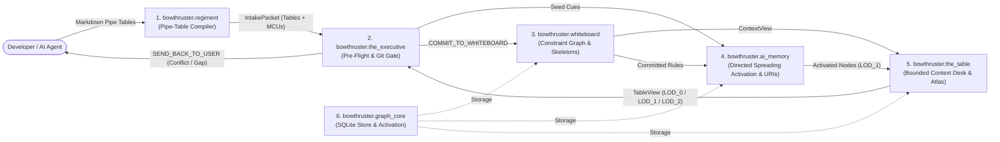

# BowThruster

**Architecture memory, focused code lookup, and pre-commit verification for AI coding agents. The board itself is the spec, eliminating manual spec writing and keeping design and code in sync automatically.**

> **Built for AI Coding Agents — Not Manual Human Bookkeeping**  
> BowThruster (`bowthruster-mcp`) is a tool for **your AI coding agent** to operate directly, not another spec format for you to maintain by hand. Anyone (or any AI agent) can clone the repo and run it immediately with Python 3.11+ (zero pip dependencies). Connect `bowthruster-mcp` to your agent and your AI builds the architecture map, pulls focused code slices, and verifies its own commits automatically.

---

## Why BowThruster

When you use an AI coding agent on a growing project, three things start going wrong:
1. **It burns time and tokens hunting through files:** To make a 15-line change, the agent greps across the repo and reads dozens of files—filling its context window with noise before it writes a single line of code.
2. **Fixing one thing breaks another:** It forgets a rule you explained earlier, or changes a function in one file without realizing three downstream modules depend on it.
3. **Architecture docs rot immediately:** Nobody has time to keep markdown specs in sync with code by hand.

**BowThruster (`bowthruster-mcp`) fixes all three.** It is a fast, deterministic MCP server (zero LLMs, zero API keys) that your AI operates directly to keep your codebase's architecture, rules, and Git history in lockstep:

- **1-Shot Code Slicing Instead of Repo Grepping:** Instead of reading whole files, your agent queries BowThruster for a function or feature and gets back a `< 2 KB` contract/function slice (`7–10 KB` when inlining full multi-interface component source with `include_code=True`) containing the exact `#L<start>-L<end>` source code, the private helpers it calls, and its upstream/downstream contracts in a single call.
- **Rules That Can't Be Silently Dropped:** Important invariants and module contracts are registered on the board instead of buried in chat history. Before a commit lands, BowThruster checks your code's AST and declared invariants—blocking the commit if an invariant was bypassed or an unrelated module was edited by mistake.
- **Automatic Blast-Radius Tracking:** When your agent changes an upstream data structure or interface, BowThruster automatically marks the affected downstream modules **`STALE`** so the agent knows exactly what else needs updating and which tests to run.
- **Works Across Languages & Repos:** Python gets full `ast` signature, call-graph, and boolean law checks, while built-in lexical symbol extractors provide `#L<start>-L<end>` line-range and helper call-tree extraction for TypeScript/JavaScript, Go, Rust, C/C++, Java, Kotlin, C#, Swift, and Ruby—and `bowthruster-mcp` automatically discovers the right board across multiple repositories from a single global MCP config.

| Without BowThruster | With BowThruster (`bowthruster-mcp`) |
| :--- | :--- |
| Agent greps and reads 20+ files (`30,000+` tokens) to find the 30 lines it needs to edit. | Agent calls `slice(..., include_code=True)` once and gets the contract + exact `#L<start>-L<end>` code lines immediately. |
| A 2-line bugfix in one module accidentally edits a neighboring verified file or drops an existing rule. | BowThruster's **pre-commit gate** (`git_sync`) verifies AST signatures, call-graph rules, and file boundaries before the commit can land. |
| Changing a shared type or API leaves downstream callers broken until a slow full-repo test run fails. | BowThruster traces directed data flows (`> FLOW`) and marks only the impacted downstream components **`STALE`** so the agent updates them and runs only their tests. |
| Architecture diagrams and `README` specs drift out of date after a few commits. | On every commit, BowThruster stamps the Git SHA, auto-heals renamed files (`git mv`), and refreshes `#L<start>-L<end>` line numbers automatically. |

---

## Quick Start

- Standard MCP JSON Config
  ```json
  {
    "mcpServers": {
      "bowthruster": {
        "command": "python3",
        "args": ["-m", "bowthruster.mcp_server"],
        "env": {
          "PYTHONPATH": "/ABSOLUTE/PATH/TO/bowthruster"
        }
      }
    }
  }
  ```

- Once connected, open any new or existing repository and tell your agent:
1. **Map the codebase:**
   > *`"Call readme(section='readme') on bowthruster and map this repository onto a board with its Charter, component Roles/Why, Flows, Interfaces, and Laws."`*
2. **Run an architectural audit:**
   > *`"With the insight you now have from the board and AST slices, what would you change about this project's architecture (e.g., monoliths doing another component's job, hidden state mutations across flows, duplicated logic, or missing seams)?"`*

---

## Agent Reference: Tools, Workflows & Pipe-Table Schema

### The 8 MCP Tools (`bowthruster` server)

| MCP Tool | Step | Key Arguments & Purpose |
| :--- | :---: | :--- |
| `readme` | **Onboard** | Fetch onboarding quickstart + unified `bowthruster` skill (`section="readme" \| "full_readme" \| "guide" \| "skill" \| "all"`). |
| `atlas` | **Step 1 (Explore / Spec)** | Render the 1-line-per-component `LOD_0` topology (Charter, Role, Why, statuses, `> FLOW` edges, metrics, and Mermaid graph) or pass `spec=True` to compile the full Markdown specification (`board`, `load_all=True`, `mermaid=True`, `spec=True`, optional `project_root`). |
| `slice` | **Step 1 (Slice + Code)** | Pull a `< 2 KB` contract/symbol slice (`7–10 KB` with full component `include_code=True`) + exact `#L<start>-L<end>` source code in one call (`board`, `component`, `query`, `include_code=True`, `mark_stale=True`, optional `project_root`). Supports windowed lookup (`query="fn_name 100-180"`), fuzzy symbol/component matching, and cross-board fallback. |
| `turn` | **Step 2 (Mutate Board)** | Compile Markdown pipe tables into the Whiteboard and mark modified/downstream components `STALE` (`board`, `speaker`, `message`, optional `project_root`). |
| `packets` | **Step 3 (Build Packet)** | Emit wave-ordered `WorkPacket`s (`laws_skeleton`, `python_skeleton`, `baseline_commit_sha`) (`board`, `component`, `status="STALE"`, optional `project_root`). |
| `git_sync` | **Step 4 (Verify & Sync)** | Run pre-commit verification + delta `pytest` + auto-verify (`mode="pre"`, `mark_verified=True`), post-commit hash/line-anchor stamp (`mode="post"`), initial baseline (`mode="baseline"`), or drift check (`mode="drift"`). |
| `status` | **Step 4 (Status)** | Transition a component's build status (`board`, `component`, `new_status="VERIFIED" \| "STALE" \| "FAILED"`). |
| `logs` | **Diagnose** | Read structured Flight Recorder telemetry (`board`, `status="ERROR" \| "REJECTED"`, `limit=20`). |

### Daily Agent Workflows

> **More Examples:** See [**`docs/examples.md`**](docs/examples.md) for walkthroughs of multi-agent parallel `STALE` dispatch, targeted QA & producer $\rightarrow$ consumer seam testing, architectural audits, and living spec generation.

#### Workflow A — Internal Fix (`0` Contract Changes, **3 Tool Calls**)
When fixing an internal bug, helper function, or threshold where no `# SCHEMA`, `$ INTERFACE`, `> FLOW`, or `% LAW` signature changes:
1. **Pull Code & Mark `STALE` in One Shot:**
   - Call `slice(board="my_board", query="verify_token", include_code=True, mark_stale=True)`
   - Returns the `< 2 KB` component contract slice, the exact `#L<start>-L<end>` code block, and transitions the owning component (`auth_service`) to `STALE` in one call. *(If exploring first without knowing whether you will edit, omit `mark_stale=True` until you pull the target function to edit.)*
2. **Edit the Code:**
   - Call `edit_file` directly using the returned `#L<start>-L<end>` lines.
3. **Pre-Commit Gate + Auto-Verify in One Shot:**
   - Call `git_sync(board="my_board", mode="pre", mark_verified=True)`.
   - Verifies AST signatures, `% LAW` call-graph reachability, `> FLOW` schemas, truth-table/Bend 2 proofs, and discovered delta `pytest` suites on the `STALE` components. When `allowed: true` and delta tests pass, it **automatically transitions `STALE` components back to `VERIFIED`** and refreshes file hashes and `#L<start>-L<end>` AST anchors.

#### Workflow B — Architectural / Contract Change (**4 Tool Calls**)
When adding or modifying a `@ COMPONENT`, `> FLOW`, `$ INTERFACE`, `# SCHEMA`, `% LAW`, or `Rule`:
1. **Explore & Slice (`atlas` / `slice`):** Inspect the component slice and existing contracts.
2. **Mutate the Board First (`turn`):** Submit the updated Markdown pipe table(s), which transitions the modified component and any impacted downstream `> FLOW` consumers from `VERIFIED` to `STALE`. *(Optional for greenfield/new laws: call `packets(status="STALE")` for `laws_skeleton` and `python_skeleton`.)*
3. **Edit the Code (`edit_file`):** Implement the updated contract and `% LAW` wiring.
4. **Pre-Commit Gate + Auto-Verify (`git_sync`):** Call `git_sync(board="my_board", mode="pre", mark_verified=True)`, run delta + producer $\rightarrow$ consumer seam tests, commit, and stamp `git_sync(board="my_board", mode="post")`.

### Canonical Pipe-Table Schema (`turn`)

Pass canonical Markdown pipe tables (`Charter`, `Component`, `Flow`, `Interface`, `Law`, plus optional `Schema` and `Rule` tables) to `turn`. `atlas(board="my_board", spec=True)` renders the complete human-readable specification directly from the board at any time:

```markdown
| Charter | Summary | Principles |
| :--- | :--- | :--- |
| my_board | Edge API gateway and stateless JWT authentication service for client requests. | Stateless token validation; zero shared mutable state between gateway workers; explicit typed contracts on all internal flows. |

| Component | Role | Why | Owner | Stage | Depends_On | Files |
| :--- | :--- | :--- | :--- | :--- | :--- | :--- |
| auth_service | JWT token validator | Isolates cryptographic signature and expiration checks so downstream handlers only receive verified AuthTokens. | backend | 1 | none | src/auth.py:L1-L120 |
| api_gateway | HTTP request router | Terminates external HTTP requests and enforces auth_check before dispatching to internal services. | backend | 1 | auth_service | src/gateway.py:L1-L150 |

| Flow | Source | Target | Payload | Condition |
| :--- | :--- | :--- | :--- | :--- |
| auth_check | api_gateway | auth_service | AuthToken | on incoming HTTP request |

| Interface | Component | Inputs | Outputs | Owner | Stage | File | Spec |
| :--- | :--- | :--- | :--- | :--- | :--- | :--- | :--- |
| verify_token | auth_service | raw_token: str | AuthToken | backend | 1 | src/auth.py:L20-L60 | Decode JWT header and payload; verify HMAC-SHA256 signature; check expires_at > now via is_token_valid; return AuthToken |
| route_request | api_gateway | request: dict | HttpResponse | backend | 1 | src/gateway.py:L30-L90 | Extract bearer token; call verify_token; verify target route exists via can_route; dispatch to upstream handler |

| Law | Component | Owner | Stage | Bend_Dir | Args | LHS | RHS | Spec |
| :--- | :--- | :--- | :--- | :--- | :--- | :--- | :--- | :--- |
| token_valid_law | auth_service | backend | 1 | laws | has_sig: Bool, not_expired: Bool | MOD.is_token_valid(has_sig, not_expired) | Bool.and(has_sig, not_expired) | Token is valid iff signature matches and expiration timestamp has not passed |
| route_allow_law | api_gateway | backend | 1 | laws | token_ok: Bool, route_exists: Bool | MOD.can_route(token_ok, route_exists) | Bool.and(token_ok, route_exists) | Request can be routed iff token is valid and route exists |

| Schema | Component | Fields | Owner | Stage | File | Spec |
| :--- | :--- | :--- | :--- | :--- | :--- | :--- |
| AuthToken | auth_service | user_id: str, expires_at: int | backend | 1 | src/auth.py:L10-L18 | Verified identity claims extracted from a signed JWT |

| Rule | Component | Type | Property | Op | Value | Condition |
| :--- | :--- | :--- | :--- | :--- | :--- | :--- |
| max_lines_rule | auth_service | BOUND | max_file_lines | <= | 500 | always |
| retry_cap_rule | api_gateway | BOUND | MAX_RETRIES | <= | 3 | always |
| no_requests_lib | api_gateway | PROHIBITION | requests | == | false | always |
```

- **When to use `Rule` (`*`) vs. `Law` (`%`):**
  - **`Rule` (`BOUND` / `PROHIBITION` / `OBLIGATION`):** Use for file line caps (`BOUND` on `max_file_lines`), module constant bounds (`BOUND` on an AST constant like `MAX_RETRIES <= 3`), banned imports (`PROHIBITION` on a module name like `requests` or `torch`, checked against AST `import` statements on `git_sync`), or component obligations (`OBLIGATION`, mounted in `slice`). Re-submitting the same `(Component, Property)` overwrites the old rule in place (`MARKOVIAN_OVERWRITE`), or attaches a conditional exception when `Condition` differs.
  - **`Law` (`% LAW`):** Reserve for multi-variable boolean state machines, routing tables, or conservation invariants ($k \ge 2$ boolean inputs, or a `Theorem` column `LHS == RHS`) that are proven in Bend 2 and called by the component's `$ INTERFACE` in the AST call graph. Never invent a 1-boolean identity law (`MOD.is_ok(x) == x`) just to mark a component `STALE`—use `slice(..., mark_stale=True)` or update the `$ INTERFACE`, `# SCHEMA`, or `Rule` row instead.

### Onboarding an Existing Repository & Installing the AI Skill / Git Hooks

1. **Compile & Verify the Baseline:** Submit the initial pipe tables via `turn`, mark existing files `VERIFIED` via `git_sync(board="my_board", mode="pre", mark_verified=True)`, and stamp the initial Git SHA via `git_sync(board="my_board", mode="post")`.
2. **Install the Unified `bowthruster` Skill:** Call `readme(section="skills")` to retrieve [`docs/skills/bowthruster/SKILL.md`](docs/skills/bowthruster/SKILL.md) and write it to `.agents/skills/bowthruster/SKILL.md` (or `.claude/skills/bowthruster/SKILL.md`), replacing `<BOARD_NAME>` and `<TEST_CMD>`.
3. **Optional Git Hooks (`.git/hooks/pre-commit` & `post-commit`):**
   ```bash
   # .git/hooks/pre-commit (chmod +x .git/hooks/pre-commit)
   #!/usr/bin/env bash
   set -euo pipefail
   LATTICE_PROJECT_ROOT="$(git rev-parse --show-toplevel)" \
     python3 -m bowthruster.cli --board <BOARD_NAME> git-sync --pre-commit

   # .git/hooks/post-commit (chmod +x .git/hooks/post-commit)
   #!/usr/bin/env bash
   set -euo pipefail
   LATTICE_PROJECT_ROOT="$(git rev-parse --show-toplevel)" \
     python3 -m bowthruster.cli --board <BOARD_NAME> git-sync --post-commit
   ```

---

## How It Works Under the Hood

BowThruster is organized into six packages under `bowthruster/`:



### 1. The 4-Layer Verification Stack
Behavioral unit tests alone leave internal program structure underdetermined ([*Skeleton Coding*, `arXiv:2610.38214`](https://arxiv.org/abs/2610.38214)): an LLM can pass a unit test with a hardcoded workaround while ignoring your architecture. BowThruster verifies both the architecture graph and the implementation across four layers:
1. **Graph Completeness & Interval Satisfiability (`whiteboard/frustration.py`):** A board only reaches `PROVEN_COMPLETE` when every `@ COMPONENT` has an owner, file path or typed `$ INTERFACE` / `# SCHEMA` contract, and connected `> FLOW` edge, with `0` open structural gaps and `0` contradictory `BOUND`/`PROHIBITION` intervals.
2. **Boolean Law Truth-Table & Bend 2 Proofs (`LATTICE_PROOF.bend` & `LAWS.bend`):** Both the board-level completeness theorem (`lattice_proof_proven_iff_complete_and_conflict_free` in `LATTICE_PROOF.bend`) and optional component `% LAW` invariants (`Args`, `LHS`, `RHS`) are compiled into formal equality theorems (`LHS == RHS` proven via inductive case analysis), verified exhaustively via truth-table evaluation (`truth_table_checked: true`) and checked by the **Bend 2 proof checker (`bend`)** when installed (`bend_binary_checked: true`).
3. **AST Signature, Call-Graph & Delta Test Gate (`the_executive/gate.py`, `call_graph.py` & `git_manifest.py`):** Before every commit (`git_sync(mode="pre")`), BowThruster parses staged Python files to verify that every declared `# SCHEMA` class and `$ INTERFACE` function exists with its required fields/parameters, every `$ INTERFACE` invokes any declared `% LAW` helper in the static call graph with non-constant, non-duplicate arguments whose result is read, every staged Python `% LAW` helper satisfies `LHS == RHS`, no `VERIFIED` file was modified without marking its component `STALE`, and discovered delta `pytest` suites pass before transitioning `STALE` components to `VERIFIED`.
4. **Finite-State Algebraic & Mutation Parity (`bend_gate.py`):** For multi-datatype state machines in `laws/*/main.bend`, compiles Bend 2 theorems to `.mjs`, exhaustively evaluates truth-table parity against Python, and runs incremental law-mutation checks (`--only-law`).

### 2. Directed Spreading Activation vs. Naive GraphRAG (`bowthruster.ai_memory`)
If you put a codebase into a naive dependency graph and walk 2 undirected hops from `auth_service`, hop 1 hits a shared utility (`types.py` or `graph_core`), and hop 2 bounces out to **every module in the repository that imports `types.py`** (`94.7%` hub noise). Conversely, restricting retrieval to 1 hop misses multi-stage data pipelines (`gateway -> router -> auth -> token_store`).

`bowthruster.ai_memory` ([`hippocampal_index.py`](bowthruster/ai_memory/hippocampal_index.py) and [`uri_resolver.py`](bowthruster/ai_memory/uri_resolver.py)) solves this with three mechanisms:
1. **Pointer-Only Storage & Git-Synchronized URIs:** `ai_memory` never copies raw source files into a vector database. It stores concept nodes holding `uri://file/<path>#L<start>-L<end>` pointers and local `_helper#L<start>-L<end>` call trees. When files are renamed (`git mv`) or line ranges shift on commit, [`sync_git_diff_uris`](bowthruster/ai_memory/uri_resolver.py) automatically heals the pointers and refreshes AST line anchors.
2. **Causal Edge-Type Separation (Data Flows vs. Shared Utilities):**
   - **Data-Flow Edges (`> FLOW`) & Scope Hierarchy:** Propagate activation both forward and backward along the pipeline (up to 6 hops) so multi-step data paths stay connected.
   - **Shared Utility Dependencies (`depends_on`):** Pulled **1 hop forward** (`caller -> utility`) into a **terminal contract sink**. You get the utility's interface contract without ever bouncing backward into unrelated callers (`0%` hub noise).
3. **Two-Ended Pipeline Bridge Recall:** When a task mentions two components at opposite ends of a pipeline (e.g., `api_gateway` and `token_store`), `recall_concepts` propagates a forward wave from the upstream component and a backward wave from the downstream component. Intermediate pipeline stages where both waves meet automatically get boosted into the active context slice—surfacing the full connecting path across up to 5 hops without pulling in unrelated branches.

### 3. Bounded Working Context (`bowthruster.the_table`) & Markovian Board Updates (`bowthruster.whiteboard`)
- **Three Levels of Detail (`LOD_0` / `LOD_1` / `LOD_2`):** `bowthruster.the_table` bounds active working memory (`max_table_slots = 16`, `max_table_tokens = 1200`), mounting `LOD_0` (`atlas`) for global topology/spec queries, `LOD_1` (50-word synopses) for neighboring components, and `LOD_2` (full contracts + `#L<start>-L<end>` code slices) for active targets.
- **Markovian Overwrite & Scope Mitosis:** Re-submitting a rule on `(Component, Property)` or a flow on `(Source, Target, Payload)` updates the existing entry in place (`MARKOVIAN_OVERWRITE`) so superseded rules and duplicate edges never accumulate. When any component exceeds `k_cap` rules (default `7`), it automatically splits along metadata axes into child sub-scopes (`comp::subscope`).

---

## Configuration (`config.json`) & Limitations

All gate policies and working-memory budgets live in [`config.json`](config.json):

| Config Key | Default | What It Controls |
| :--- | :---: | :--- |
| `gate.max_file_lines` | `null` *(off)* | Optional maximum line count per file enforced by `git-sync --pre-commit` and `status ... VERIFIED` (can also be set per-component via a `Rule` table `BOUND` row). |
| `gate.verify_files_exist_on_status` | `true` | Verifies that all declared component files exist on disk (and pass `max_file_lines` if set) before allowing `status(..., new_status="VERIFIED")`. |
| `gate.require_call_graph_laws` | `true` | Requires every `$ INTERFACE` function in a staged `.py` file to invoke its component's `% LAW` helper functions in the AST call graph. |
| `lattice.k_cap` | `7` | Maximum rules per scope before automatic sub-scope mitosis (`comp::subscope`). |
| `lattice.max_table_slots` / `max_table_tokens` | `16` / `1200` | Working-memory slot and token budget for `bowthruster.the_table`. |
| `lattice.hub_bottleneck_min_dependents` | `3` | Minimum number of downstream dependents before a component is flagged in `hub_bottlenecks` on `atlas`. |

### Known Limitations (What BowThruster Does Not Replace)
1. **Static AST & Boolean Law Proofs Complement Behavioral Tests:**
   - The pre-commit gate (`evaluate_git_commit_gate` + `verify_ast_call_graph_skeleton`) and Bend 2 (`bend check`) prove that no `VERIFIED` component was edited without marking it `STALE`, declared `# SCHEMA` classes/fields and `$ INTERFACE` functions/parameters exist in the AST, every `$ INTERFACE` calls its governing `% LAW` helper without discarding the return value, and every `% LAW` formula (`LHS == RHS`) is mathematically sound.
   - However, static checks cannot prove that an algorithm computes the right intermediate values before passing booleans to a `% LAW` helper, or that SQL queries, I/O, or runtime state mutations behave correctly. Component-scoped unit and producer $\rightarrow$ consumer seam tests (`pytest` on `changed_scopes | stale_dependents`) remain essential.
2. **Enforcement Is Bounded by What Is Declared on the Board:**
   - `evaluate_git_commit_gate` verifies schemas, interfaces, laws, bounds, and import prohibitions registered on the board (and flags `unregistered_public_symbols` on modified files). If an internal helper introduces an undeclared side effect not governed by a board rule, promote a new `Rule`, `# SCHEMA`, or `% LAW` onto the board via `turn`.

---

## License

Licensed under the **Functional Source License, Version 1.1, Apache 2.0 Future License (`FSL-1.1-Apache-2.0`)**. See [LICENSE](LICENSE) for full terms.
