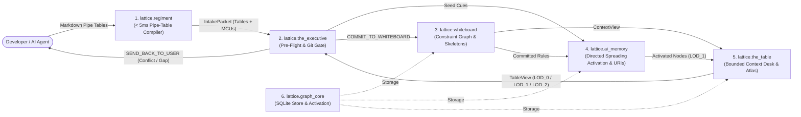

# Lattice

**Architecture memory, focused code lookup, and pre-commit verification for AI coding agents. The Lattice itself is the spec, eliminating manual spec writing and keeping design and code in sync automatically.**

> **Built for AI Coding Agents — Not Manual Human Bookkeeping**  
> Lattice (`lattice-mcp`) is a tool for **your AI coding agent** to operate directly, not another spec format for you to maintain by hand. You connect `lattice-mcp` to your agent (Claude Code, Cursor, Antigravity, Windsurf, etc.), and your AI builds the architecture map, pulls focused code slices, and verifies its own commits automatically.
>
> **Try it in 60 seconds:** Connect `lattice-mcp` and paste this to your AI:  
> *`"Call lattice_readme(section='readme') and explain to me in plain English how Lattice would change how we build and maintain this repository — then map this codebase onto a Lattice board."`*

When you use an AI coding agent on a growing project, three things start going wrong:
1. **It burns time and tokens hunting through files:** To make a 15-line change, the agent greps across the repo and reads dozens of files—filling its context window with noise before it writes a single line of code.
2. **Fixing one thing breaks another:** It forgets a business rule you explained earlier, or changes a function in one file without realizing three downstream modules depend on it.
3. **Architecture docs rot immediately:** Nobody has time to keep markdown specs in sync with code by hand.

**Lattice (`lattice-mcp`) fixes all three.** It is a fast (`< 50ms`), deterministic MCP server (zero LLMs, zero API keys) that your AI operates directly to keep your codebase's architecture, rules, and Git history in lockstep:

- **1-Shot Code Slicing Instead of Repo Grepping:** Instead of reading whole files, your agent queries Lattice for a function or feature and gets back a `< 2 KB` slice containing the exact `#L<start>-L<end>` source code, the private helpers it calls, and its upstream/downstream contracts in a single call.
- **Rules That Can't Be Silently Dropped:** Important invariants and module contracts are registered on the Lattice board instead of buried in chat history. Before a commit lands, Lattice checks your code's AST and formal invariants in **~50ms**—blocking the commit if an invariant was bypassed or an unrelated module was edited by mistake.
- **Automatic Blast-Radius Tracking:** When your agent changes an upstream data structure or interface, Lattice automatically marks the affected downstream modules **`STALE`** so the agent knows exactly what else needs updating and which tests to run.
- **Works Across Languages & Repos:** Supports Python, TypeScript/JavaScript, Go, Rust, C/C++, Java, Kotlin, C#, Swift, and Ruby—and automatically discovers the right board across multiple repositories from a single global MCP config.

---

## Part 1: How Daily Work Changes with Lattice

| Without Lattice | With Lattice (`lattice-mcp`) |
| :--- | :--- |
| Agent greps and reads 20+ files (`30,000+` tokens) to find the 30 lines it needs to edit. | Agent calls `lattice_slice(..., include_code=True)` once and gets the `< 2 KB` contract + exact `#L<start>-L<end>` code lines immediately. |
| A 2-line bugfix in one module accidentally edits a neighboring verified file or drops an existing rule. | Lattice's **50ms pre-commit gate** (`lattice_git_sync`) verifies AST signatures, call-graph rules, and file boundaries before the commit can land. |
| Changing a shared type or API leaves downstream callers broken until a slow full-repo test run fails. | Lattice traces directed data flows (`> FLOW`) and marks only the impacted downstream components **`STALE`** so the agent updates them and runs only their tests. |
| Architecture diagrams and `README` specs drift out of date after a few commits. | On every commit, Lattice stamps the Git SHA, auto-heals renamed files (`git mv`), and refreshes `#L<start>-L<end>` line numbers automatically. |

---

## Part 2: Onboarding & Daily Workflow (`lattice-mcp`)

### 2.0 Registering `lattice-mcp` as a First-Class MCP Tool

So your AI coding agent calls `lattice_atlas`, `lattice_slice`, `lattice_turn`, `lattice_packets`, `lattice_git_sync`, `lattice_status`, `lattice_logs`, and `lattice_readme` as native first-class MCP tools (instead of falling back to raw shell commands or `read_file`), register `lattice.mcp_server` in your AI host's MCP server configuration using this standard stdio server spec:

```json
{
  "mcpServers": {
    "lattice": {
      "command": "<ABSOLUTE_PATH_TO_PYTHON>",
      "args": ["-m", "lattice.mcp_server"],
      "env": {
        "PYTHONPATH": "<ABSOLUTE_PATH_TO_LATTICE_DIR>",
        "LATTICE_PROJECT_ROOT": "<ABSOLUTE_PATH_TO_TARGET_REPO>"
      }
    }
  }
}
```
- **`command` / `args`:** Runs the stdio MCP server (`python3 -m lattice.mcp_server`) using the Python environment where `mcp` and `pydantic` are installed.
- **`PYTHONPATH`:** Path to the `lattice/` package root so `import lattice` resolves from any working directory.
- **`LATTICE_PROJECT_ROOT`:** Root directory of the repository being tracked (where `.whiteboard/<board>.json` and the tracked source files live).

Once registered, the server exposes **8 first-class MCP tools**:

| MCP Tool | Workflow Step | Key Arguments & Purpose |
| :--- | :---: | :--- |
| `lattice_readme` | **Onboard** | Fetch onboarding docs or the unified `lattice` skill template (`section="readme" \| "guide" \| "skill" \| "all"`). |
| `lattice_atlas` | **Step 1 (Explore / Spec)** | Render the 1-line-per-component `LOD_0` topology (with Charter, Role, Why/Rationale, statuses, `> FLOW` edges, metrics, and optional Mermaid graph) or pass `spec=True` to compile the full human-readable Markdown specification (`board`, `load_all=True`, `mermaid=True`, `spec=True`). |
| `lattice_slice` | **Step 1 (Slice + Code)** | Pull a `< 2 KB` component/symbol slice + exact `#L<start>-L<end>` source code in one call (`board`, `component`, `query`, `include_code=True`, `mark_stale=True`). |
| `lattice_turn` | **Step 2 (Mutate Board)** | Compile Markdown pipe tables into the Whiteboard in `< 50ms` and mark modified/downstream components `STALE` (`board`, `speaker`, `message`). |
| `lattice_packets` | **Step 3 (Build Packet)** | Emit wave-ordered `WorkPacket`s (`laws_skeleton`, `python_skeleton`, `baseline_commit_sha`) (`board`, `component`, `status="STALE"`). |
| `lattice_git_sync` | **Step 4 (Verify & Sync)** | Run pre-commit verification + auto-verify (`mode="pre"`, `mark_verified=True`), post-commit hash/line-anchor stamp (`mode="post"`), initial baseline (`mode="baseline"`), or drift check (`mode="drift"`). |
| `lattice_status` | **Step 4 (Status)** | Transition a component's build status (`board`, `component`, `new_status="VERIFIED" \| "STALE" \| "FAILED"`). |
| `lattice_logs` | **Diagnose** | Read structured Flight Recorder telemetry (`board`, `status="ERROR" \| "REJECTED"`, `limit=20`). |

### 2.1 Daily Agent Workflow: 3 Calls for Internal Fixes vs. 4 Calls for Contract Changes

Once a repository is onboarded, your AI coding agent uses two streamlined workflows depending on whether a change is **internal** or **architectural**:

#### Workflow A — Internal Implementation Fix (`0` Contract Changes, **3 Tool Calls**)
When fixing an internal bug, helper function, or threshold where no `# SCHEMA`, `$ INTERFACE`, `> FLOW`, or `% LAW` signature changes, the agent takes the **exact same 3 steps** as raw `read_file` $\rightarrow$ `edit_file` $\rightarrow$ `test`, with zero extra bookkeeping calls:
1. **Pull Code & Mark `STALE` in One Shot:**
   - Call `lattice_slice(board="my_board", query="verify_token", include_code=True, mark_stale=True)`
   - Returns the `< 2 KB` component contract slice, the exact `#L<start>-L<end>` code block, and transitions the owning component (`auth_service`) to `STALE` in one call. *(If exploring first without knowing whether you will edit, call `lattice_slice(..., include_code=True)` first, and pass `mark_stale=True` only when pulling the target function to edit.)*
2. **Edit the Code:**
   - Call `edit_file` directly using the returned `#L<start>-L<end>` code lines.
3. **50ms Pre-Commit Gate + Auto-Verify in One Shot:**
   - Call `lattice_git_sync(board="my_board", mode="pre", mark_verified=True)` (and run delta `pytest -k auth_service`).
   - Verifies all AST signatures, `% LAW` call-graph reachability, `> FLOW` schemas, and Bend 2 proofs in ~50ms, and when `allowed: true`, **automatically transitions `STALE` components back to `VERIFIED`** (`marked_verified_scopes: ["auth_service"]`) and refreshes their file hashes and `#L<start>-L<end>` AST anchors.

#### Workflow B — Architectural / Contract Change (**4 Tool Calls**)
When adding or modifying a `@ COMPONENT`, `> FLOW`, `$ INTERFACE`, `# SCHEMA`, `% LAW`, or `Rule`:
1. **Explore & Slice (`lattice_atlas` / `lattice_slice`):** Inspect the component slice and existing contracts.
2. **Mutate the Board First (`lattice_turn`):** Submit the updated Markdown pipe table(s) (`< 50ms`), which transitions the modified component and any impacted downstream `> FLOW` consumers from `VERIFIED` to `STALE`. *(Optional for greenfield/new laws: call `lattice_packets(status="STALE")` for `laws_skeleton` and `python_skeleton`.)*
3. **Edit the Code (`edit_file`):** Implement the updated contract and `% LAW` wiring.
4. **50ms Pre-Commit Gate + Auto-Verify (`lattice_git_sync`):** Call `lattice_git_sync(board="my_board", mode="pre", mark_verified=True)`, run delta + producer $\rightarrow$ consumer seam tests, commit, and stamp `lattice_git_sync(board="my_board", mode="post")`.

### 2.2 Onboarding a New or Existing Codebase in 4 Steps

You do **not** need to rewrite existing code to adopt Lattice. Any greenfield design or existing ("brownfield") repository can be onboarded in four steps:

#### Step 1: Inspect or Initialize a Board (`lattice_atlas`)
Check active boards in `.whiteboard/`:
- Call `lattice_atlas(board="my_board", load_all=True)`

#### Step 2: Compile the Architecture & Intent to `PROVEN_COMPLETE` (`lattice_turn`)
Pass the canonical Markdown pipe tables (`Charter`, `Component`, `Flow`, `Interface`, `Law` — plus optional `Schema` and `Rule` tables) to `lattice_turn`. Because Lattice is built for AI agents that emit structured Markdown natively, `lattice_turn` compiles pipe tables **100% deterministically in `< 50ms`** with zero LLM calls and zero API keys—and `lattice_atlas(board="my_board", spec=True)` (or `lattice --board my_board atlas --spec`) renders the complete human-readable Markdown specification (`# <Board> — Living Architecture & Intent Specification`) directly from the board at any time:

```markdown
| Charter | Summary | Principles |
| :--- | :--- | :--- |
| my_board | Edge API gateway and stateless JWT authentication service for client requests. | Stateless token validation (<5ms); zero shared mutable state between gateway workers; explicit typed contracts on all internal flows. |

| Component | Role | Why | Owner | Stage | Depends_On | Files |
| :--- | :--- | :--- | :--- | :--- | :--- | :--- |
| auth_service | JWT token validator | Isolates cryptographic signature and expiration checks so downstream handlers only receive verified AuthTokens. | backend | 1 | none | src/auth.py:L1-L120 |
| api_gateway | HTTP request router | Terminates external HTTP requests and enforces auth_check before dispatching to internal services. | backend | 1 | auth_service | src/gateway.py:L1-L150 |

| Flow | Source | Target | Payload | Condition |
| :--- | :--- | :--- | :--- | :--- |
| auth_check | api_gateway | auth_service | AuthToken | on incoming HTTP request |

| Interface | Component | Inputs | Outputs | Owner | Stage | File | Spec |
| :--- | :--- | :--- | :--- | :--- | :--- | :--- | :--- |
| verify_token | auth_service | raw_token: str | AuthToken | backend | 1 | src/auth.py:L20-L60 | Spec 1 |
| route_request | api_gateway | request: dict | HttpResponse | backend | 1 | src/gateway.py:L30-L90 | Spec 1 |

| Law | Component | Owner | Stage | Bend_Dir | Args | LHS | RHS | Spec |
| :--- | :--- | :--- | :--- | :--- | :--- | :--- | :--- | :--- |
| token_valid_law | auth_service | backend | 1 | laws | has_sig: Bool, not_expired: Bool | MOD.is_token_valid(has_sig, not_expired) | Bool.and(has_sig, not_expired) | Spec 1 |
| route_allow_law | api_gateway | backend | 1 | laws | token_ok: Bool, route_exists: Bool | MOD.can_route(token_ok, route_exists) | Bool.and(token_ok, route_exists) | Spec 1 |
```
*(Optional tables: `| Schema | Component | Fields | Owner | Stage | File | Spec |` for data models, and `| Rule | Component | Type | Property | Op | Value | Condition |` for numeric/boolean bounds such as `| max_lines_rule | auth_service | BOUND | max_file_lines | <= | 500 | always |`. In Law tables, you can provide either `LHS` and `RHS` columns or a `Theorem` column written as `LHS == RHS`. **Anti-Tautology `% LAW` Rule:** Reserve `% LAW` for multi-variable boolean state machines, routing tables, or conservation invariants ($k \ge 2$ boolean inputs); never invent a 1-boolean identity law like `MOD.is_ok(x) == x` just to mark a component `STALE` for a bug fix — instead, update the affected `$ INTERFACE`, `# SCHEMA`, or `Rule` row.)*

#### Step 3: Generate Skeletons (Greenfield) or Stamp the Baseline (Brownfield)
- **For Greenfield components:** Call `lattice_packets(board="my_board", component="auth_service")` to get the component's `laws_skeleton` (`LAWS.bend`) and `python_skeleton` (typed Python stub with `# MUST CALL` anchors), implement the files, and run `lattice_git_sync(board="my_board", mode="pre")`.
- **For Existing (Brownfield) codebases:**
  1. Mark existing components `VERIFIED` (this checks that every declared file exists on disk and satisfies any active `max_file_lines` bound):
     - Call `lattice_status(board="my_board", component="auth_service", new_status="VERIFIED")`
  2. Stamp the initial Git baseline (`commit_sha` and `file_hashes` — when run for the first time on a board or with `mode="baseline"`, this records `HEAD` as the clean baseline without diffing `HEAD~1..HEAD`):
     - Call `lattice_git_sync(board="my_board", mode="post")`

#### Step 4: Install the Unified `lattice` AI Skill & Git Hooks
To ensure future AI sessions in this repository automatically follow the 4-step Lattice workflow without re-reading this README or juggling multiple separate skills:

1. **Fetch & Install the Unified `lattice` Skill (`lattice_readme(section="skills")`)**:
   - Call `lattice_readme(section="skills")` to retrieve the canonical [`docs/skills/lattice/SKILL.md`](docs/skills/lattice/SKILL.md) template.
   - Write it into the repository's `.agents/skills/lattice/SKILL.md` (or `.claude/skills/lattice/SKILL.md`), **replacing `<BOARD_NAME>` with this repository's actual board name and `<TEST_CMD>` with this repository's test command** (e.g., `.venv/bin/pytest -k`).
   - Because all four steps (**1. Explore & Slice Code** `lattice_slice(include_code=True)` $\rightarrow$ **2. Mutate Board (`STALE`)** `lattice_turn` $\rightarrow$ **3. Build Skeleton** `lattice_packets` $\rightarrow$ **4. Pre-Commit Gate, Seam Test & Sync** `lattice_git_sync` + `lattice_status`) live in **one ~45-line skill** and are reinforced directly on the MCP tool schemas, the AI loads the complete workflow in a single read with zero skill split-brain.

2. **Install `.git/hooks/pre-commit` & `.git/hooks/post-commit`**:
   Wire `git-sync` into `.git/hooks/` so every commit automatically runs the 50ms pre-commit gate and post-commit hash/line sync:
   ```bash
   # .git/hooks/pre-commit (chmod +x .git/hooks/pre-commit)
   #!/usr/bin/env bash
   set -euo pipefail
   LATTICE_PROJECT_ROOT="$(git rev-parse --show-toplevel)" \
     python3 -m lattice.cli --board <BOARD_NAME> git-sync --pre-commit

   # .git/hooks/post-commit (chmod +x .git/hooks/post-commit)
   #!/usr/bin/env bash
   LATTICE_PROJECT_ROOT="$(git rev-parse --show-toplevel)" \
     python3 -m lattice.cli --board <BOARD_NAME> git-sync --post-commit
   ```

---

## Part 3: Deep Technical Architecture & Why Each Subsystem Works

Lattice is organized into six packages under `lattice/`:



### 3.1 How Lattice Proves Architecture & Code (The 4-Layer Verification Stack)

Behavioral unit tests alone leave internal program structure underdetermined ([*Skeleton Coding*, `arXiv:2610.38214`](https://arxiv.org/abs/2610.38214)): an LLM can pass a unit test with a hardcoded workaround while ignoring your architecture. Lattice verifies both the architecture graph and the Python implementation across four layers:

1. **Graph Completeness & Interval Satisfiability (`evaluate_lattice_proof` in `whiteboard/frustration.py`):**
   A board only reaches `PROVEN_COMPLETE` when every `@ COMPONENT` has an owner, file path, typed `$ INTERFACE` contract, connected `> FLOW` edge, and at least one `% LAW` invariant, with `0` open structural gaps and `0` contradictory `BOUND`/`PROHIBITION` intervals.
2. **Formal Dependent-Type Proofs in Bend 2 (`LATTICE_PROOF.bend` & `LAWS.bend`):**
   Every `% LAW` (`Args`, `LHS`, `RHS`) is compiled into a formal equality theorem (`LHS == RHS` proven via `rewrite` reflexivity and inductive case analysis over `Bool`/`Nat`) and checked by the **Bend 2 proof checker (`bend check`)**.
3. **50ms AST Signature & Call-Graph Skeleton Gate (`verify_ast_call_graph_skeleton` in `the_executive/gate.py`):**
   Before every commit (`lattice_git_sync(mode="pre")`), Lattice parses the staged Python files with `ast` to verify that:
   - Every declared `# SCHEMA` class and `$ INTERFACE` function exists with its required fields/parameters.
   - Every `$ INTERFACE` entrypoint invokes its governing `% LAW` helper function(s) in the static AST call graph (`0` disconnected law functions).
   - Every declared file exists on disk and no local relative imports point to deleted modules.
4. **Truth-Table & Mutation Parity (`bend_gate.py`):**
   Compiles Bend 2 theorems to `.mjs`, exhaustively evaluates all boolean input combinations to verify exact truth-table parity with the Python `% LAW` helper functions, and runs incremental law-mutation checks (`--only-law`).

---

### 3.2 `lattice.ai_memory`: Why Standard Vector RAG & GraphRAG Fail on Code, and How Directed Spreading Activation Works

If you put a codebase into a naive graph and walk 2 undirected hops from `auth_service`, hop 1 hits a shared utility (`types.py` or `graph_core`), and hop 2 bounces out to **every module in the repository that imports `types.py`** (`94.7%` hub noise, $F_1 = 0.660$). Conversely, if you restrict retrieval to 1 hop, you miss 4-stage data pipelines (`gateway -> router -> auth -> token_store`).

`lattice.ai_memory` ([`hippocampal_index.py`](lattice/ai_memory/hippocampal_index.py) and [`uri_resolver.py`](lattice/ai_memory/uri_resolver.py)) solves this with three mechanisms:

1. **Pointer-Only Storage & Git-Synchronized URIs (`pointer_only_storage_law`):**
   `ai_memory` never copies raw source files into a vector database. It stores concept nodes holding `uri://file/<path>#L<start>-L<end>` pointers. When files are renamed (`git mv`) or line ranges shift on commit, [`sync_git_diff_uris`](lattice/ai_memory/uri_resolver.py) automatically heals the pointers and refreshes AST line anchors.
2. **Causal Edge-Type Separation (`Directed Multi-Cue Push`):**
   - **Data-Flow Edges (`> FLOW`) & Scope Hierarchy:** Propagate activation both forward and backward up to `MAX_RECALL_HOPS = 6` ($\gamma = 0.85$, threshold $\epsilon = 0.04$), damped only by directional flow degree $1 / \sqrt{\deg_{\text{flow}}(u)}$.
   - **Shared Utility Dependencies (`depends_on`):** Pulled **1 hop forward** (`caller -> utility`) into a **terminal contract sink** (`steiner_bridge_and_sink_isolation_law`: `can_propagate_from_node(is_contract_sink=True) == False`). You get the utility's interface contract without ever bouncing backward into unrelated callers.
3. **Multi-Cue Steiner Bridge Intersection ($\beta = 0.85$):**
   When a task mentions two or more components $(s_1, s_2)$ at opposite ends of a pipeline, `recall_concepts` propagates a forward wave $a^+(s_1, v)$ and a backward wave $a^-(s_2, v)$. Intermediate pipeline components where both waves meet receive a converging bridge boost:
   $$a_{\text{total}}(v) = \min\!\left(1.0,\; a_{\text{base}}(v) + \beta \sum_{s_1 < s_2} \max\!\left(\sqrt{a^+(s_1, v)\,a^-(s_2, v)},\; \sqrt{a^+(s_2, v)\,a^-(s_1, v)}\right)\right)$$
   Across live boards and synthetic benchmarks ($N \in \{12, 30, 60\}$), this raises retrieval accuracy from **$F_1 = 0.660$ (`94.7%` hub noise)** on undirected 2-hop BFS to **$F_1 = 0.989$ (`100%` 5-hop bridge recall, `0.0%` hub noise)**.

---

### 3.3 `lattice.the_table`: Solving the "Paper-Towel Tube vs. Rabbit-Hole" Context Problem

AI agents fail when they have either **tunnel vision** (seeing only one function, like looking through a paper-towel tube) or **unbounded exploration** (seeing the whole file tree and reading 20 unrelated files out of curiosity).

`lattice.the_table` ([`surface.py`](lattice/the_table/surface.py), [`renderer.py`](lattice/the_table/renderer.py), [`workspace_sync.py`](lattice/the_table/workspace_sync.py)) manages the agent's active working context as a bounded desk (`max_table_slots = 16`, `max_table_tokens = 1200`):

- **Three Levels of Detail (`LOD_0` / `LOD_1` / `LOD_2`):**
  - **`LOD_0` (`lattice_atlas`):** A compact 1-line-per-component topology of components, verification statuses, and `> FLOW` edges (~15–20 tokens per component, plus a `flowchart LR` Mermaid diagram; large systems can be queried per-board or across all boards). Governed by `atlas_mode_isolation_law`, `LOD_0` is mounted on global architectural queries and withheld during local component edits so the agent stays focused.
  - **`LOD_1` (50-Word Synopses):** Compact component summaries loaded by Stage 1 `ai_memory` recall.
  - **`LOD_2` (Full Contracts & `file:Lstart-Lend` Slices):** Full rules, interfaces, schemas, and source line anchors for the active target components.
- **Zero-Wandering Stage 2 Escalation (`forage_table_context`):**
  Governed by `stage2_foraging_budget_law`, if Pre-Flight detects zero conflicts and zero missing references, Stage 2 performs **`0` extra lookups**. Only when Pre-Flight detects a conflict or ungrounded identifier on a component does Stage 2 escalate that slot from `LOD_1` to `LOD_2`, pin it (`pinned_slot_eviction_immunity_law`), and expand its 1-hop neighbors.

---

### 3.4 `lattice.whiteboard`, `lattice.the_executive` & `lattice.regiment`

- **`lattice.whiteboard` (Markovian Rule Overwrite & Scope Mitosis):**
  - When a new rule updates an existing parameter on a component, Stage 4B ([`linker.py`](lattice/whiteboard/linker.py)) classifies the delta as `MARKOVIAN_OVERWRITE` (replacing the old bound in-place), `LEX_SPECIALIS_EXCEPTION` (wiring an explicit conditional exception edge), or `ORTHOGONAL_INSERT`. Old superseded rules never linger in active context.
  - When any component scope exceeds `k_cap` rules (default `7`), it automatically splits along orthogonal metadata axes (`stage`, `owner`, `condition`) into child sub-scopes (`comp::subscope`) so individual slices stay small.
- **`lattice.the_executive` (Trial Cloning & Pre-Flight Conflict Gate):**
  - On every `lattice_turn`, [`preflight.py`](lattice/the_executive/preflight.py) clones the board and test-applies the proposed rules. If a rule contradicts an existing `BOUND`/`PROHIBITION` or leaves a premise ungrounded, [`gate.py`](lattice/the_executive/gate.py) rejects the commit (`SEND_BACK_TO_USER`) and cites the exact conflicting rule IDs without mutating the board.
- **`lattice.regiment` (`< 5ms` Deterministic Pipe-Table Compiler):**
  - Because AI coding agents generate structured Markdown effortlessly, `lattice.regiment` parses only structured Markdown pipe tables (`Component`, `Flow`, `Interface`, `Law`, `Schema`, `Rule`) plus canonical `FLOW` lines (`The <source> component sends <Payload> to <target>.`) in **`< 5ms` with zero LLM calls, zero `spacy`/`torch` dependencies, and zero API keys**.
  - If an agent passes unstructured prose or unrecognized table headers to `lattice_turn`, `lattice.regiment` immediately fails fast (`< 1ms`) with an explicit schema guide listing all 6 canonical pipe-table headers.

### 3.5 Multi-Language & Polyglot Codebases (Not Just Python)

Although the Lattice engine itself is implemented in zero-dependency Python + SQLite + Bend 2, **Lattice is not a Python-only tool**. It is designed to track and verify repositories in **any programming language** (`.ts`, `.tsx`, `.js`, `.go`, `.rs`, `.java`, `.kt`, `.c`, `.cpp`, `.cs`, `.swift`, `.rb`, `.py`, `.bend`, or polyglot monorepos):

| Capability | Works Across All Languages (`.ts`, `.go`, `.rs`, `.cpp`, `.java`, `.py`, etc.) | How It Works |
| :--- | :---: | :--- |
| **Architecture Circuit & Pre-Flight Conflict Gate (`lattice_turn`, `lattice_atlas`)** | **Yes (`100%`)** | `@ COMPONENT`, `> FLOW`, `$ INTERFACE`, `# SCHEMA`, `% LAW`, and `* BOUND` rules track any file path (`src/auth.ts`, `pkg/router.go`, `src/lib.rs`, `src/auth.py`). |
| **Formal Theorem Proving in Bend 2 (`LAWS.bend` & `LATTICE_PROOF.bend`)** | **Yes (`100%`)** | `% LAW` boolean state-machine and routing invariants are proven in **Bend 2**, independent of the target application language. |
| **One-Shot Symbol + Code Slicing (`lattice_slice(query="...", include_code=True)`)** | **Yes (`100%`)** | Built-in extractors (`AST_EXTRACTORS`) resolve functions, classes, interfaces, structs, enums, and arrow exports (`#L<start>-L<end>` spans + intra-file `_helper#L<start>-L<end>` call trees) across `.py`, `.ts`/`.tsx`/`.js`/`.jsx`/`.mjs`, `.go`, `.rs`, `.java`/`.kt`, `.c`/`.cpp`/`.h`, `.cs`, `.swift`, `.rb`, and `.bend` (extensible via `register_ast_extractor(ext, fn)`). |
| **Git Edit Guard, Rename Healing, Line Shifts & `STALE` Cascades (`lattice_git_sync`)** | **Yes (`100%`)** | `verified_scope_edit_guard_law` (blocking edits to `VERIFIED` files of any extension unless marked `STALE`), `git mv` URI healing, `git diff` `#L<start>-L<end>` line-shift healing, `max_file_lines` bounds, `> FLOW` schema checks, and downstream `STALE` cascades are completely language-independent. |
| **WorkPacket Skeletons (`lattice_packets`) & Deep Call-Graph Verification** | **Polyglot (`LAWS.bend` + `prompt_slice` universal; `python_skeleton` for `.py`)** | Every `WorkPacket` emits the universal `prompt_slice`, `baseline_commit_sha`, and formal `LAWS.bend` (`laws_skeleton`), plus a reference `python_skeleton` stub. On `lattice_git_sync(mode="pre")`, deep `ast.parse` signature + `% LAW` call-graph reachability runs on `.py` files while all language-general gates and symbol extractors run on every language. |

---

## Part 4: Zero-LLM Runtime & Configuration (`config.json`)

Every Lattice operation (`lattice_readme`, `lattice_atlas`, `lattice_slice`, `lattice_packets`, `lattice_turn`, `lattice_git_sync`, `lattice_status`, `lattice_logs`) is **100% deterministic Python, SQLite, Python `ast`, and Bend 2**:
- **`0` LLM API calls & `0` API keys required**
- **`0 GB` local model weights / GPU RAM (`mcp` + `pydantic` only)**
- **`< 50ms` turn compilation and pre-commit verification**

All gate policies and working-memory budgets live in [`config.json`](config.json):

```json
{
  "gate": {
    "max_file_lines": null,
    "verify_files_exist_on_status": true,
    "require_call_graph_laws": true
  },
  "lattice": {
    "k_cap": 7,
    "max_ring": 5,
    "max_table_slots": 16,
    "max_table_tokens": 1200,
    "max_pinned_slots": 6,
    "max_slot_summary_words": 50,
    "max_foraging_steps": 4,
    "hub_bottleneck_min_dependents": 3
  }
}
```

| Config Key | Default | What It Controls |
| :--- | :---: | :--- |
| `gate.max_file_lines` | `null` *(off)* | Optional maximum line count per `.py`/`.bend` file enforced by `git-sync --pre-commit` and `status ... VERIFIED` (can also be set per-component via a `Rule` table `BOUND` row). |
| `gate.verify_files_exist_on_status` | `true` | Verifies that all declared component files actually exist on disk (and pass `max_file_lines` if set) before allowing `lattice_status(..., new_status="VERIFIED")`. |
| `gate.require_call_graph_laws` | `true` | Requires every `$ INTERFACE` function in a staged `.py` file to invoke its component's `% LAW` helper functions in the AST call graph (`Stage 27`). |
| `lattice.k_cap` | `7` | Maximum rules per scope before automatic sub-scope mitosis (`comp::subscope`). |
| `lattice.max_table_slots` / `max_table_tokens` | `16` / `1200` | Working-memory slot and token budget for `lattice.the_table`. |
| `lattice.hub_bottleneck_min_dependents` | `3` | Minimum number of downstream dependents before a component is flagged in `hub_bottlenecks` on `lattice_atlas`. |

---

## Part 5: Design Boundaries & Known Limitations (What Lattice Does Not Replace)

Lattice is a **prescriptive architecture circuit and verification gate**, not a copy of your source code or a replacement for Git. Understanding what Lattice intentionally leaves out is essential for using it well:

1. **AI Memory Tracks `#L<start>-L<end>` Line Ranges, Local Private Helper Call Trees, and On-the-Fly AST Code Slicing:**
   - `lattice.ai_memory` (`sync_git_diff_uris`) automatically extracts AST `(lineno, end_lineno)` spans and stamps `file=<path>#L<start>-L<end>` pointers (plus `uri://file/<path>#L<start>-L<end>` `external_links`) onto every declared `# SCHEMA` class and `$ INTERFACE` function, **and** attaches `calls=[_helper#L<start>-L<end>, ...]` listing the intra-file private helper functions called by each `$ INTERFACE`.
   - Furthermore, `lattice_slice(board="...", query="<symbol>", include_code=True)` scans the board's declared `files` on the fly to locate **any** AST symbol (including private `_helper` functions not registered on the board) and returns both its owning `@ COMPONENT` contract slice and its exact numbered `#L<start>-L<end>` source code block in one call.
   - In addition, `evaluate_git_commit_gate` reports `unregistered_public_symbols` whenever a component's files define public functions or classes that have not yet been registered as `$ INTERFACE` or `# SCHEMA` rows on the board.

2. **Git Owns Diffs & History (`baseline_commit_sha` Instead of Board Diffs):**
   - Lattice does not duplicate `git diff` or track removed lines/files inside the board JSON. Instead, every WorkPacket records `baseline_commit_sha` (the last commit synchronized via `lattice_git_sync(mode="post")`). When refactoring or removing deprecated files, the agent inspects `git diff <baseline_commit_sha>` to see exact file and line changes.

3. **Static AST & Boolean Law Proofs Do Not Replace Behavioral Tests:**
   - The `50ms` pre-commit gate (`evaluate_git_commit_gate` + `verify_ast_call_graph_skeleton`) and Bend 2 (`bend check`) prove that:
     - No file in a `VERIFIED` component was edited without marking the component `STALE` first (`verified_scope_edit_guard_law`),
     - Declared `# SCHEMA` classes/fields and `$ INTERFACE` functions/parameters exist in the Python AST,
     - Every `$ INTERFACE` invokes its governing `% LAW` helper in the static call graph without discarding the return value (`_ = law(...)`), and
     - Every `% LAW` boolean formula (`LHS == RHS`) is mathematically sound.
   - **What static gates cannot prove:** Neither AST call-graph reachability nor finite boolean laws can prove that an algorithm computes the right intermediate values before passing booleans to a `% LAW` helper, or that SQL queries, I/O, or state mutations behave correctly at runtime. Fast, component-scoped unit/integration tests (`pytest` on `changed_scopes | stale_dependents`) remain necessary.

4. **Enforcement Is Bounded by What Is Declared on the Board:**
   - `evaluate_git_commit_gate` only verifies schemas, interfaces, laws, and import prohibitions that are registered on the board. If an internal helper introduces an undeclared side effect, dynamic `importlib` call, or performance regression not governed by a board rule, Lattice will not flag it automatically—the agent must diagnose it in the component's source files and, if it represents a standing architectural invariant, promote a new `Rule` or `% LAW` onto the board via `lattice_turn`.

---

## License

Licensed under the **Functional Source License, Version 1.1, Apache 2.0 Future License (`FSL-1.1-Apache-2.0`)**. See [LICENSE](LICENSE) for full terms.


