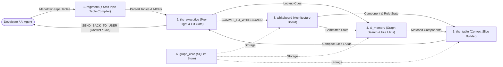
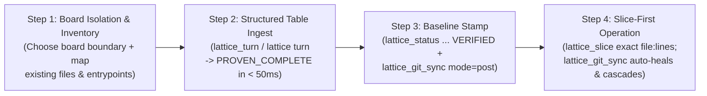

# Lattice: Architecture, Product Guide & Onboarding Reference

> **Built for AI Coding Agents — Not Manual Human Bookkeeping**  
> **Lattice** is a **language-agnostic** MCP toolset (`lattice-mcp`) built for **AI coding agents** to operate directly across **TypeScript/JavaScript, Go, Rust, C/C++, Java, Kotlin, C#, Swift, Ruby, Python, or polyglot repositories**. Instead of relying on humans to maintain markdown docs or expecting an AI to grep through thousands of lines of code on every turn, your AI uses Lattice to keep your repository architecture, module contracts, formal invariants, and Git commits in lockstep.
>
> **Quickest way to start:** Connect `lattice-mcp` and tell your AI:  
> *`"Call lattice_readme(section='readme') and explain to me how Lattice would help us develop this repo — then onboard this codebase onto a Lattice board."`*

---

## 1. What Problem Does Lattice Solve?

AI coding agents and multi-agent workflows routinely hit four practical problems on real codebases:

1. **Contradictory Instructions & Stale Docs:** Markdown architecture docs and agent memory stores accept whatever text they are given. When a rule changes later, old and new rules coexist in context until an agent writes code against the wrong assumption.
2. **Spec Drift Across Handoffs:** Passing long prose specifications or chat logs between agents causes subtle interface mismatches (`arg` names, return types, file paths) to compound over 3–4 turns.
3. **Noisy Dependency Traversal:** Walking 2 undirected hops through a shared utility module (like `types.py` or `db.py`) pulls in 95% of the repository as irrelevant noise, while a 1-hop walk misses multi-step data-flow pipelines.
4. **Full-Repo Exploration ("Rabbit-Holing") vs. Tunnel Vision:** If an agent only sees one file, it breaks upstream/downstream callers. If it sees the whole repo tree, it wastes tens of thousands of tokens reading unrelated files.

**Lattice** solves these by maintaining a live, structured architecture board (`.whiteboard/<board>.json`) backed by SQLite, formal Bend 2 proofs, and Python AST verification:
- **100% Deterministic, `< 50ms` per Turn (`0` LLMs, `0` API Keys, `0 GB` Model Weights):** Because AI coding agents generate structured Markdown pipe tables effortlessly, every Lattice operation (`lattice_readme`, `lattice_atlas`, `lattice_slice`, `lattice_packets`, `lattice_turn`, `lattice_git_sync`, `lattice_status`, `lattice_logs`) executes deterministically in milliseconds.
- **Conflict-Checked Architecture Board (`whiteboard` + `the_executive`):** Every component, file path, public interface, data flow, and numeric/boolean bound is checked for structural completeness (`0` open gaps) and interval satisfiability before it is committed to the board.
- **Formal Bend 2 Theorem Proving + AST Call-Graph Verification (`LATTICE_PROOF.bend` + `verify_ast_call_graph_skeleton`):** Every `% LAW` invariant is compiled into a formal dependent-type proof checked by **Bend 2 (`bend check`)** and paired with a pure Python helper function. At pre-commit time (`lattice_git_sync(mode="pre")`), Python's `ast` parser verifies in ~50ms that every `$ INTERFACE` and `# SCHEMA` matches its declared signature and that every `$ INTERFACE` calls its governing `% LAW` helper functions in the static call graph.
- **Focused Context + Code Slices (`the_table` + `ai_memory` + `whiteboard`):** Agents can view a compact 1-line-per-component topology (`lattice_atlas`, ~15–20 tokens per component, scoped per board or across all boards) or pull a `< 2 KB` slice (`lattice_slice(..., include_code=True)`) that resolves any AST symbol (including private `_helper` functions) and returns its exact `#L<start>-L<end>` source code in one call.
- **Git Sync & Directed Blast-Radius Cascade (`lattice_git_sync`):** Automatically heals renamed file URIs across `git mv` and cascades `STALE` status downstream along directed `> FLOW` edges whenever an upstream component's contract changes.

---

## 2. How the Six Packages Fit Together



| # | Package (`lattice/`) | What It Does | Key Modules |
| :-: | :--- | :--- | :--- |
| **1** | **[`lattice.regiment`](../lattice/regiment/)** | **Deterministic Pipe-Table Compiler (`< 5ms`):** Parses structured Markdown pipe tables (`Component`, `Flow`, `Interface`, `Law`, `Schema`, `Rule`) and canonical `FLOW` lines into structured components (`@ COMPONENT`), data flows (`> FLOW`), schemas (`# SCHEMA`), interfaces (`$ INTERFACE`), laws (`% LAW`), and bounds (`* BOUND`) with zero LLM calls and zero `spacy`/`torch` dependencies. | `intake_packet.py`, `markdown_tables.py` |
| **2** | **[`lattice.the_executive`](../lattice/the_executive/)** | **Pre-Flight Checker & Git Gate:** Tests proposed board updates on a trial copy (`preflight.py`), rejects contradictory rules or missing references (`gate.py`), verifies Python AST signatures and call graphs (`verify_ast_call_graph_skeleton`), and runs the Git pre-commit/post-commit gate (`evaluate_git_commit_gate`). | `preflight.py`, `gate.py`, `voice.py`, `orchestrator.py` |
| **3** | **[`lattice.whiteboard`](../lattice/whiteboard/)** | **Architecture Board & Skeleton Compiler:** Stores components, flows, interfaces, and rules (`schema.py`, `mutations.py`), checks whether a board is `PROVEN_COMPLETE` (`frustration.py`), generates per-component `WorkPacket`s (`python_skeleton` + `laws_skeleton` in `ingest.py`), and tracks build status (`DRAFT`, `READY`, `STALE`, `VERIFIED`). | `schema.py`, `mutations.py`, `frustration.py`, `linker.py`, `rewriter.py`, `read_engine.py`, `ingest.py` |
| **4** | **[`lattice.ai_memory`](../lattice/ai_memory/)** | **Dependency Search & File URI Tracker:** Finds relevant components along directed `> FLOW` pipelines without pulling in unrelated callers of shared utilities (`hippocampal_index.py`), and keeps `file:Lstart-Lend` pointers synchronized across `git mv` renames (`uri_resolver.py`). | `schema.py`, `cue_extractor.py`, `hippocampal_index.py`, `uri_resolver.py` |
| **5** | **[`lattice.the_table`](../lattice/the_table/)** | **Bounded Context Builder & Atlas Renderer:** Assembles compact working-context views within a configurable token budget (`surface.py`, `workspace_sync.py`) and renders the 1-line-per-component topology map (`render_lattice_atlas`) in ASCII and Mermaid (`renderer.py`). | `schema.py`, `surface.py`, `renderer.py`, `workspace_sync.py` |
| **6** | **[`lattice.graph_core`](../lattice/graph_core/)** | **SQLite Graph Storage:** Provides SQLite persistence (`SQLiteGraphStore`), token counting (`token_cost`), and graph traversal utilities shared across the board and CLI. | `sqlite_store.py`, `slicing.py`, `activation.py`, `polarity.py` |

---

## 3. Deep Technical Dive: AI Memory, Context Slicing & Formal Verification

### 3.1 `lattice.ai_memory`: Directed Multi-Cue Spreading Activation & Steiner Bridge Intersection
In a real codebase, utility modules (`types.py`, `graph_core`, `db.py`) are imported by almost every component. Standard 2-hop undirected graph traversal (`BFS`) hits `types.py` on hop 1 and bounces out to **94.7% of the repository as irrelevant noise** on hop 2 ($F_1 = 0.660$). Conversely, restricting retrieval to 1 hop misses 4-hop data pipelines (`gateway -> router -> auth -> token_store`).

[`recall_concepts`](../lattice/ai_memory/hippocampal_index.py) and [`sync_git_diff_uris`](../lattice/ai_memory/uri_resolver.py) solve this with three mechanisms:
- **Pointer-Only Storage (`pointer_only_storage_law`):** `ai_memory` never duplicates raw source files into a vector database. Concept nodes store `uri://file/<path>#L<start>-L<end>` pointers that automatically heal across `git mv` renames and line-number shifts on commit.
- **Edge-Type Separation (`Directed Multi-Cue Push`):**
  - **Data-Flow Edges (`> FLOW`) & Scope Hierarchy:** Propagate activation both forward and backward up to `MAX_RECALL_HOPS = 6` ($\gamma = 0.85$, threshold $\epsilon = 0.04$), damped only by directional flow degree $1 / \sqrt{\deg_{\text{flow}}(u)}$.
  - **Shared Utility Dependencies (`depends_on`):** Pulled **1 hop forward** (`caller -> utility`) into a **terminal contract sink** (`steiner_bridge_and_sink_isolation_law`: `can_propagate_from_node(is_contract_sink=True) == False`), exposing the utility's contract while strictly blocking reverse collider bounces (`caller_A -> utility -> caller_B`).
- **Multi-Cue Steiner Bridge Intersection ($\beta = 0.85$):** When a query contains $\ge 2$ seed cues $(s_1, s_2)$, intermediate pipeline stages where the forward wave $a^+(s_1, v)$ meets the backward wave $a^-(s_2, v)$ receive a converging bridge boost:
  $$a_{\text{total}}(v) = \min\!\left(1.0,\; a_{\text{base}}(v) + \beta \sum_{s_1 < s_2} \max\!\left(\sqrt{a^+(s_1, v)\,a^-(s_2, v)},\; \sqrt{a^+(s_2, v)\,a^-(s_1, v)}\right)\right)$$
  Across live boards and synthetic lattices ($N \in \{12, 30, 60\}$), this raises retrieval accuracy from **$F_1 = 0.660$ (`94.7%` hub noise)** on undirected 2-hop BFS to **$F_1 = 0.989$ (`100%` 5-hop bridge recall, `0.0%` hub noise)**.

### 3.2 `lattice.the_table`: Bounded Context Desk (`LOD_0` / `LOD_1` / `LOD_2`) & Zero-Wandering Escalation
To prevent agents from either having tunnel vision ("looking through a paper-towel tube") or compulsively reading unrelated files ("rabbit-holing"), [`lattice.the_table`](../lattice/the_table/surface.py) bounds working memory (`max_table_slots = 16`, `max_table_tokens = 1200`):
- **Three Levels of Detail (`LOD_0` / `LOD_1` / `LOD_2`):**
  - **`LOD_0` (`lattice_atlas`):** Renders a single board or all boards in `.whiteboard/` into a 1-line-per-component schematic (`atlas_schematic`, scaling linearly at ~15–20 tokens per component with zero arbitrary truncation), health metrics (`atlas_metrics`), and `flowchart LR` Mermaid diagram (`atlas_mermaid`). Governed by `atlas_mode_isolation_law`, `LOD_0` is mounted on global architectural queries and withheld during local component edits.
  - **`LOD_1` (50-Word Synopses):** Compact component summaries loaded by Stage 1 `ai_memory` recall.
  - **`LOD_2` (Full Contracts & `file:Lstart-Lend` Slices):** Full rules, interfaces, schemas, and source line anchors for active target components (`< 2 KB` per component via `lattice_slice`).
- **Zero-Wandering Stage 2 Escalation (`forage_table_context`):** Governed by `stage2_foraging_budget_law`, if Pre-Flight detects zero conflicts and zero missing references, Stage 2 executes **`0` extra lookups**. Only when Pre-Flight detects a conflict or ungrounded identifier on a component does Stage 2 escalate that slot from `LOD_1` to `LOD_2`, pin it (`pinned_slot_eviction_immunity_law`), and expand 1-hop neighbors.

### 3.3 `lattice.whiteboard`, `lattice.the_executive` & `lattice.regiment`: Markovian Overwrite, 4-Layer Proofs & `< 5ms` Pipe-Table Compilation
- **Markovian Rule Overwrite & Lex Specialis Exceptions (`linker.py`):** When a rule is updated, Stage 4B classifies the delta as `MARKOVIAN_OVERWRITE` (replacing the superseded bound in-place), `LEX_SPECIALIS_EXCEPTION` (wiring an explicit conditional exception edge), or `ORTHOGONAL_INSERT`.
- **Automatic Scope Mitosis (`k_cap = 7`):** When any component scope exceeds `k_cap` rules, it splits along orthogonal metadata axes (`stage`, `owner`, `condition`) into child sub-scopes (`comp::subscope`) so individual slices stay small.
- **Four-Layer Proof Engine:**
  1. **Graph Completeness & Interval Satisfiability (`evaluate_lattice_proof`):** Requires every `@ COMPONENT` to have an owner, file path, `$ INTERFACE`, connected `> FLOW`, and `% LAW`, with `0` contradictory `BOUND`/`PROHIBITION` intervals.
  2. **Formal Theorem Proving in Bend 2 (`LATTICE_PROOF.bend` & `LAWS.bend`):** Compiles every `% LAW` into a dependent-type equality proof checked by `bend check`.
  3. **50ms AST Signature & Call-Graph Gate (`verify_ast_call_graph_skeleton`):** Parses Python files with `ast` on `lattice_git_sync(mode="pre")` to verify `# SCHEMA` and `$ INTERFACE` signatures, `$ INTERFACE` $\rightarrow$ `% LAW` static call-graph reachability (`0` disconnected laws), file existence, and zero dangling relative imports.
  4. **Truth-Table & Mutation Parity (`bend_gate.py`):** Verifies exhaustive boolean truth-table parity between Bend 2 `.mjs` and Python `% LAW` helpers and runs `--only-law` mutation checks.
- **`< 5ms` Deterministic Pipe-Table Compiler (`lattice.regiment`):** Parses structured Markdown pipe tables (`Component`, `Flow`, `Interface`, `Law`, `Schema`, `Rule`) deterministically in `< 5ms` with zero LLM calls and fails fast (`< 1ms`) with the canonical header guide if unstructured prose is passed.
- **Built-In Multi-Language Symbol & Call-Tree Extraction (`AST_EXTRACTORS`):** Out of the box, Lattice extracts symbol `(start_line, end_line)` spans (`#L<start>-L<end>`) and intra-file `_helper#L<start>-L<end>` call trees across `.py`, `.ts`/`.tsx`/`.js`/`.jsx`/`.mjs`, `.go`, `.rs`, `.java`/`.kt`, `.c`/`.cpp`/`.h`, `.cs`, `.swift`, `.rb`, and `.bend` (and accepts custom extractors via `register_ast_extractor(ext, fn)`), so `lattice_slice(query="...", include_code=True)`, `verified_scope_edit_guard_law`, `git mv` URI healing, and `> FLOW` `STALE` cascades work across any language.

---

## 4. Zero-LLM Runtime & Configuration (`config.json`)

Every Lattice operation (`lattice_readme`, `lattice_atlas`, `lattice_slice`, `lattice_packets`, `lattice_turn`, `lattice_git_sync`, `lattice_status`, `lattice_logs`) runs deterministically in Python, SQLite, `ast`, and Bend 2 (`0` LLM tokens, `0` API keys, `0 GB` model weights):

```json
{
  "gate": {
    "max_file_lines": null,
    "verify_files_exist_on_status": true,
    "require_call_graph_laws": true
  },
  "lattice": {
    "k_cap": 7,
    "max_ring": 5,
    "max_table_slots": 16,
    "max_table_tokens": 1200,
    "max_pinned_slots": 6,
    "max_slot_summary_words": 50,
    "max_foraging_steps": 4,
    "hub_bottleneck_min_dependents": 3
  }
}
```

| Config Key | Default | What It Controls |
| :--- | :---: | :--- |
| `gate.max_file_lines` | `null` *(off)* | Optional maximum line count per `.py`/`.bend` file enforced by `git-sync --pre-commit` and `status ... VERIFIED` (can also be set per-component via a `Rule` table `BOUND` row). |
| `gate.verify_files_exist_on_status` | `true` | Verifies that all declared component files actually exist on disk (and pass `max_file_lines` if set) before allowing `lattice_status(..., new_status="VERIFIED")`. |
| `gate.require_call_graph_laws` | `true` | Requires every `$ INTERFACE` function in a staged `.py` file to invoke its component's `% LAW` helper functions in the AST call graph (`Stage 27`). |
| `lattice.k_cap` | `7` | Maximum rules per scope before automatic sub-scope mitosis (`comp::subscope`). |
| `lattice.max_table_slots` / `max_table_tokens` | `16` / `1200` | Working-memory slot and token budget for `lattice.the_table`. |
| `lattice.hub_bottleneck_min_dependents` | `3` | Minimum number of downstream dependents before a component is flagged in `hub_bottlenecks` on `lattice_atlas`. |

---

## 5. Best Practices for Operating the Lattice (`lattice-mcp`)

### 5.1 Use Structured Markdown Pipe Tables to Compile Boards to `PROVEN_COMPLETE` in 1 Turn (`< 50ms`)
- **Why:** Markdown pipe tables are extracted deterministically in `< 5ms` (`markdown_tables.py`) and fused directly into the Lattice in `Stage 4A` ([`fuse_table_attributes`](../lattice/whiteboard/rewriter.py)).
- **Best Practice:** Pass the four canonical structured tables (`Component`, `Flow`, `Interface`, `Law` — plus optional `Schema` and `Rule` tables):
  1. `| Component | Role | Owner | Stage | Depends_On | Files |`
  2. `| Flow | Source | Target | Payload | Condition |`
  3. `| Interface | Component | Inputs | Outputs | Owner | Stage | File | Spec |`
  4. `| Law | Component | Owner | Stage | Bend_Dir | Args | LHS | RHS | Spec |` *(or use a `Theorem` column `LHS == RHS`)*
  5. `| Schema | Component | Fields | Owner | Stage | File | Spec |` *(optional)*
  6. `| Rule | Component | Type | Property | Op | Value | Condition |` *(optional)*

### 5.2 Code Against Both Generated Skeletons (`laws_skeleton` + `python_skeleton`, `arXiv:2610.38214`)
- **Why:** Behavioral unit tests alone leave internal program structure underdetermined ([*Skeleton Coding*, `arXiv:2610.38214`](https://arxiv.org/abs/2610.38214)).
- **Best Practice:** Always call `lattice_packets(board="<board>", component="<comp>")`. Every `WorkPacket` emits two deterministic skeletons at zero LLM token cost:
  1. **`laws_skeleton` ([`compile_laws_bend`](../lattice/whiteboard/ingest.py)):** Ready-to-prove `LAWS.bend` formal theorems.
  2. **`python_skeleton` ([`compile_python_skeleton`](../lattice/whiteboard/ingest.py)):** `ast.parse`-verified Python stub containing `@dataclass(frozen=True)` schemas (`# SCHEMA`), pure Bend-verified helper functions (`% LAW`), and typed entrypoint signatures (`$ INTERFACE`) with `# MUST CALL: <law_fn>(...)` call-graph anchors (enforced by [`verify_ast_call_graph_skeleton`](../lattice/the_executive/gate.py)).

### 5.3 Run Lattice-Scoped Incremental QA (`< 5 Seconds`), Never Full-Suite Regressions on Small Deltas
1. **Step 1 — 50ms Pre-Commit Structural & Call-Graph Gate:** Call `lattice_git_sync(board="<board>", mode="pre")` to verify `<= 500` lines, `# SCHEMA`/`$ INTERFACE` signatures, `$ INTERFACE` $\rightarrow$ `% LAW` AST call-graph reachability, `> FLOW` payload schemas, Bend 2 proofs, and zero dangling local imports in **50ms**.
2. **Step 2 — `< 2s` Delta-Scoped & Seam Tests (`<= 80` lines):** Test **only** scopes in `changed_scopes | stale_dependents` via `pytest -k <changed_interface>` (including an unmocked producer $\rightarrow$ consumer seam test when touching a `> FLOW` edge).

### 5.4 Synchronize the Lattice with Git on Every Commit (`lattice_git_sync`)
- Call `lattice_git_sync(board="<board>", mode="pre")` before committing (blocks commits that delete referenced files, introduce dangling local imports, or break contracts/bounds/proofs).
- Call `lattice_git_sync(board="<board>", mode="post")` after committing (auto-heals renamed `uri://file/...` pointers via [`sync_git_diff_uris`](../lattice/ai_memory/uri_resolver.py), refreshes AST `#Lstart-Lend` line anchors, stamps `last_commit_sha`, and cascades `STALE` to downstream `VERIFIED` dependents when contracts change).
- Call `lattice_git_sync(board="<board>", mode="drift")` at any time for a read-only check of uncommitted working-tree drift.
- **Recommended Git Hook Setup (`.git/hooks/pre-commit` & `.git/hooks/post-commit`):**
  ```bash
  # .git/hooks/pre-commit (chmod +x .git/hooks/pre-commit)
  #!/usr/bin/env bash
  set -euo pipefail
  LATTICE_PROJECT_ROOT="$(git rev-parse --show-toplevel)" \
    python3 -m lattice.cli --board my_board git-sync --pre-commit

  # .git/hooks/post-commit (chmod +x .git/hooks/post-commit)
  #!/usr/bin/env bash
  LATTICE_PROJECT_ROOT="$(git rev-parse --show-toplevel)" \
    python3 -m lattice.cli --board my_board git-sync --post-commit
  ```

### 5.5 Updating the Lattice & Making Code Fixes (`STALE` WorkPacket Workflow)
- **Never edit a `VERIFIED` component's code before marking it `STALE`.**
- **Workflow A — Internal Implementation Fixes (3 Tool Calls, `0` Contract Changes):**
  1. Call `lattice_slice(board="my_board", query="<function_or_helper>", include_code=True, mark_stale=True)` to retrieve the `< 2 KB` component slice + `#L<start>-L<end>` code block and transition the owning component to `STALE` in one shot.
  2. Call `edit_file` directly on the returned lines.
  3. Call `lattice_git_sync(board="my_board", mode="pre", mark_verified=True)` (plus delta `pytest`), which runs the 50ms pre-commit gate and automatically transitions `STALE` components back to `VERIFIED` when `allowed: true`.
- **Workflow B — Architectural / Contract Changes (4 Tool Calls):**
  1. **Update the Lattice First via `lattice_turn`:** Call `lattice_turn` with a pipe-table row adding/updating the `% LAW`, `$ INTERFACE`, `# SCHEMA`, `> FLOW`, or `BOUND` rule. Committing automatically transitions the modified component (and affected downstream dependents) to `build_status=STALE` while keeping the board `PROVEN_COMPLETE`.
  2. **Fetch or Dispatch the `STALE` WorkPacket via `lattice_packets`:** Call `lattice_packets(board="my_board", status="STALE")` (or `component="<comp>"`) to get the updated `prompt_slice`, `laws_skeleton`, and `python_skeleton`.
  3. **Implement Against the Skeleton (`edit_file`):** Update the component file(s) so `$ INTERFACE` calls the `% LAW` helper.
  4. **Pre-Commit Gate + Auto-Verify & Stamp Post-Commit:** Call `lattice_git_sync(board="my_board", mode="pre", mark_verified=True)` and `lattice_git_sync(board="my_board", mode="post")`.

---

## 6. Brownfield Migration Guide: Onboarding an Existing Codebase to the Lattice

When a team or AI agent already has an existing codebase, **no code rewrite is required**. You onboard an existing codebase into a live, git-synchronized Lattice in four steps:



### Step 1: Choose Board Boundaries & Inventory Existing Modules (`file:Lstart-Lend`)
1. **Separate Product Boards from Tooling/Infra Boards:** Keep separate git repositories or distinct architectural domains on their own isolated boards (e.g., `--board lattice_core` for the core library vs. `--board mcp_server_28` for the MCP server).
2. **Inventory Components, Entrypoints, and Laws:** Group existing files into logical components (`@ COMPONENT`), recording each public entrypoint (`$ INTERFACE`), schema (`# SCHEMA`), and governing boolean invariant (`% LAW`).

### Step 2: Compile the Board to `PROVEN_COMPLETE` via Structured Pipe Tables (`< 50ms`)
Call `lattice_turn(board="my_board", speaker="agent", message="...")` with the canonical pipe tables:

```markdown
| Component | Role | Owner | Stage | Depends_On | Files |
| :--- | :--- | :--- | :--- | :--- | :--- |
| ticket_switchboard | P0/P1 ticket routing and untagged-spec gate | groves | 26 | none | scripts/tickets.py:L1-L350 |
| whiteboard_cli | Multi-board session CLI and git-sync driver | groves | 26 | ticket_switchboard | scripts/whiteboard_session.py:L1-L490 |
| bend_gate_runner | Formal Bend 2 proof and --only-law mutation runner | groves | 27 | whiteboard_cli | scripts/bend_gate.py:L1-L463 |

| Flow | Source | Target | Payload | Condition |
| :--- | :--- | :--- | :--- | :--- |
| ticket_to_cli | ticket_switchboard | whiteboard_cli | TicketPayload | on P0 dispatch |
| cli_to_bend | whiteboard_cli | bend_gate_runner | GatePayload | on pre-commit verification |

| Interface | Component | Inputs | Outputs | Owner | Stage | File | Spec |
| :--- | :--- | :--- | :--- | :--- | :--- | :--- | :--- |
| cmd_open | ticket_switchboard | args: Namespace | int | groves | 26 | scripts/tickets.py:L120-L210 | Spec 26 |
| cmd_git_sync | whiteboard_cli | args: Namespace | int | groves | 26 | scripts/whiteboard_session.py:L360-L435 | Spec 26 |
| check_directory | bend_gate_runner | bend_dir: Path, only_laws: set[str] | GateVerdict | groves | 27 | scripts/bend_gate.py:L280-L390 | Spec 27 |

| Law | Component | Owner | Stage | Bend_Dir | Args | LHS | RHS | Spec |
| :--- | :--- | :--- | :--- | :--- | :--- | :--- | :--- | :--- |
| ticket_gate_law | ticket_switchboard | groves | 26 | scripts | has_tag: Bool, valid_owner: Bool | MOD.can_open_ticket(has_tag, valid_owner) | Bool.and(has_tag, valid_owner) | Require spec tag and valid owner |
| git_sync_cli_law | whiteboard_cli | groves | 26 | scripts | pre_ok: Bool, proofs_ok: Bool | MOD.can_sync_commit(pre_ok, proofs_ok) | Bool.and(pre_ok, proofs_ok) | Require pre-commit gate and proofs |
| incremental_law_filter | bend_gate_runner | groves | 27 | scripts | has_filter: Bool, match_only: Bool | MOD.should_check_law(has_filter, match_only) | Bool.or(Bool.not(has_filter), match_only) | Filter laws when --only-law is set |
```

### Step 3: Stamp the Baseline State (`VERIFIED` + `lattice_git_sync` + Git Hooks)
1. **Mark existing components `VERIFIED`:**
   - Call `lattice_status(board="my_board", component="auth_service", new_status="VERIFIED")`
2. **Stamp Git Commit SHA and File Digests (`mode="post"` / `mode="baseline"`):**
   - Call `lattice_git_sync(board="my_board", mode="post")`
3. **Install `.git/hooks/pre-commit` & `.git/hooks/post-commit`:** Wire `git-sync --pre-commit` and `--post-commit` into `.git/hooks/` (see §5.4) so every commit is gated and synchronized automatically.

### Step 4: Install the Unified `lattice` AI Skill (`.agents/skills/lattice/SKILL.md`)
1. **Fetch the Canonical Skill Template:** Call `lattice_readme(section="skill")` (or `section="skills"`).
2. **Install & Customize into `.agents/skills/lattice/SKILL.md` (or `.claude/skills/lattice/SKILL.md`):** Replace `<BOARD_NAME>` with the repository's actual board name and `<TEST_CMD>` with the repository's test command so every future AI session in the repo loads the complete 4-step workflow in a single read:
   - **Step 1 (Explore & Slice Code):** `lattice_atlas` $\rightarrow$ `lattice_slice(query="...", include_code=True)` (one-shot slice + `#L<start>-L<end>` code without `read_file` or `grep`).
   - **Step 2 (Mutate Board First):** `lattice_turn` with canonical pipe tables (marks affected components `STALE`; enforces the Anti-Tautology `% LAW` rule).
   - **Step 3 (Build `STALE` WorkPacket):** `lattice_packets(status="STALE")` $\rightarrow$ implement against `python_skeleton` & `laws_skeleton`.
   - **Step 4 (`< 5s` Gate, Seam Test & Sync):** `lattice_git_sync(mode="pre")` $\rightarrow$ test `changed_scopes | stale_dependents` (with unmocked `> FLOW` producer $\rightarrow$ consumer seams) $\rightarrow$ `lattice_status(..., "VERIFIED")` + `lattice_git_sync(mode="post")`.
