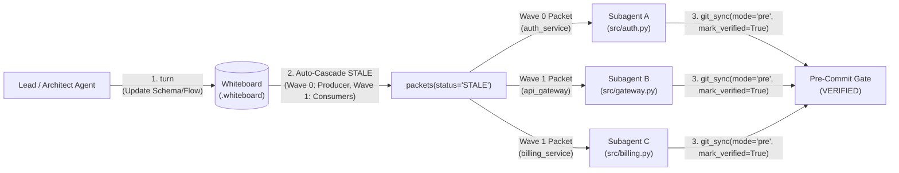

# BowThruster Workflow Examples

Practical examples of how AI coding agents use `bowthruster-mcp` for multi-agent coordination, targeted QA, architectural audits, and living documentation.

---

## 1. Multi-Agent Parallel Dispatch (`turn` $\rightarrow$ `STALE` Cascade $\rightarrow$ Subagents)

When an architectural change updates a shared data structure or API, a single agent editing everything sequentially is slow—and multiple agents editing files without boundaries step on each other's work.

BowThruster coordinates multi-agent work using **`STALE` cascades** and **wave-ordered `WorkPacket`s**:



### Step-by-Step Multi-Agent Flow

1. **Lead Agent Updates the Contract on the Board (`turn`):**
   Suppose `auth_service` adds a new field (`tenant_id: str`) to the `AuthToken` schema that flows into `api_gateway` and `billing_service`:
   ```markdown
   | Schema | Component | Fields | Owner | Stage | File | Spec |
   | :--- | :--- | :--- | :--- | :--- | :--- | :--- |
   | AuthToken | auth_service | user_id: str, tenant_id: str, expires_at: int | backend | 1 | src/auth.py | Verified identity and tenant claims extracted from a signed JWT |

   | Flow | Source | Target | Payload | Condition |
   | :--- | :--- | :--- | :--- | :--- |
   | auth_to_gateway | auth_service | api_gateway | AuthToken | on authenticated request |
   | auth_to_billing | auth_service | billing_service | AuthToken | on metered API call |
   ```
   - `turn` updates `AuthToken` in place and **automatically transitions `auth_service` (producer) and `api_gateway` + `billing_service` (downstream consumers) from `VERIFIED` to `STALE`**, while leaving all other components `VERIFIED`.

2. **Lead Agent Pulls Wave-Ordered `WorkPacket`s (`packets`):**
   - Calling `packets(board="my_board", status="STALE")` returns self-contained packets ordered by dependency wave:
     - **Wave 0 (`auth_service`):** Contains `auth_service`'s contract slice, declared `Files` (`src/auth.py`), and `AuthToken` schema requirements.
     - **Wave 1 (`api_gateway`, `billing_service`):** Contains each consumer's contract slice, upstream `> FLOW` payload (`AuthToken`), and declared `Files`.

3. **Subagents Execute in Parallel Without Collisions:**
   - The Lead Agent dispatches a subagent for each `STALE` component with its `WorkPacket`.
   - **Scope Isolation (`verified_scope_edit_guard_law`):** If Subagent B (`api_gateway`) accidentally edits a `VERIFIED` file belonging to another component, `git_sync(mode="pre")` blocks the commit and names the offending file.
   - **Concurrency Safety:** `bowthruster-mcp` guards board reads/writes with cross-process file locks (`flock`), so parallel subagents can call `slice` and `git_sync` simultaneously.

---

## 2. Targeted QA & Producer $\rightarrow$ Consumer Seam Testing

Standard unit test suites fail in two ways with AI agents:
1. **Mock Drift:** Agent A updates `auth_service` to return `AuthToken(user_id=..., tenant_id=..., expires_at=...)`. Agent B's unit test for `billing_service` still mocks the old return value, so all unit tests pass while the real pipeline crashes.
2. **Slow Full-Repo Test Runs:** Running the entire test suite after every small edit wastes minutes.

### How BowThruster Changes the QA Loop

1. **Blast-Radius Test Selection (`changed_scopes | stale_dependents`):**
   When an agent runs `git_sync(board="my_board", mode="pre")`, BowThruster identifies the exact modified components and their downstream `> FLOW` dependents. Instead of running the entire test suite, the QA agent runs only the affected component tests:
   ```bash
   pytest -k "auth_service or api_gateway or billing_service"
   ```

2. **Static `> FLOW` Payload Schema Verification:**
   Before tests even run, `git_sync(mode="pre")` checks `flow_schema_checked`: for every `> FLOW Source --[Payload]--> Target` where `Payload` is a `# SCHEMA`, BowThruster parses the AST to verify the `# SCHEMA` class exists with all declared fields.

3. **Unmocked Producer $\rightarrow$ Consumer Seam Tests:**
   Every `> FLOW Source --[Payload]--> Target` edge on the board defines a required **unmocked integration seam**. When a QA agent (or coding agent) sees:
   ```text
   @ FLOW auth_service --[AuthToken]--> billing_service
   ```
   it writes or runs a seam test that calls the real `auth_service` interface and feeds its actual output directly into `billing_service` with zero mocks:
   ```python
   def test_seam_auth_service_to_billing_service():
       token = verify_token(raw_jwt)          # Producer ($ INTERFACE on auth_service)
       receipt = record_usage(token, units=1) # Consumer ($ INTERFACE on billing_service)
       assert isinstance(token, AuthToken)
       assert receipt.tenant_id == token.tenant_id
   ```

---

## 3. Architectural Audit & Mechanical Pre-Commit Gate Catches

### A. Auditing a Codebase Using `Charter` + Component `Why`

Once a repository is mapped onto a board with a project `Charter` and component `Why` rationales, your AI agent can evaluate whether the code actually respects its intended boundaries.

Prompt your agent:
> *`"Inspect atlas(board='my_board', spec=True) and the component slices. Where does the current implementation violate a component's Why rationale or the Charter principles?"`*

Typical issues the agent catches from the board + AST slices:
- **Cross-Component State Mutation:** A request handler (`api_gateway`) directly mutating billing ledger state instead of passing an event payload along a `> FLOW` edge to `billing_service`.
- **Boundary Leakage:** A downstream service reaching into private `_parse_claims` helpers owned by `auth_service` instead of consuming the declared `$ INTERFACE` (`verify_token`).

### B. What the Pre-Commit Gate Catches Automatically (`git_sync(mode="pre")`)

Even if an agent forgets a structural rule during coding, `git_sync(board="my_board", mode="pre", mark_verified=True)` blocks the commit when any of the following occur:

| Gate Violation | What the Agent Did Wrong | How BowThruster Blocks It |
| :--- | :--- | :--- |
| **`VERIFIED_SCOPE_EDIT_VIOLATION`** | Edited a file in a `VERIFIED` component without marking it `STALE` first (`mark_stale=True` or `turn`). | Rejects the commit and lists the modified `VERIFIED` file path. |
| **`CONTRACT_VIOLATION`** | Renamed/deleted a declared `$ INTERFACE` function or `# SCHEMA` class, or dropped a required parameter. | Parses the staged file's AST and reports the missing symbol or parameter. |
| **`CALL_GRAPH_LAW_VIOLATION`** | Wrote a `% LAW` helper function (`is_token_valid`) but never called it inside `verify_token`, or discarded its result (`_ = is_token_valid(...)`). | Walks the static AST call graph across the component's files and rejects disconnected or discarded law calls. |
| **`BEND_PROOF_FAILURE`** | Changed a Python `% LAW` helper (`is_token_valid`) to `return True` or `not exp or sig` instead of `not exp and sig`. | Transpiles the staged Python function's AST into Bend 2, checks `LHS == RHS` across all boolean assignments and via `bend`, and rejects the commit. |
| **`BOUND_VIOLATION`** | Exceeded `max_file_lines` (e.g., `<= 500`) or set a module constant `MAX_RETRIES = 10` when a `Rule` requires `MAX_RETRIES <= 3`. | Checks file line counts and top-level AST numeric constants against active `BOUND` rules. |
| **`PROHIBITION_VIOLATION`** | Added `import requests` or `import torch` in a component with a `PROHIBITION` rule on that library. | Parses AST `import` / `from ... import` nodes and blocks prohibited modules. |

---

## 4. Generating a Living Specification & Mermaid Diagram (`atlas(spec=True)`)

Because the board stores the project `Charter`, component `Role` and `Why`, directed `> FLOW` edges, `#L<start>-L<end>` `Interfaces`, `Schemas`, `Laws`, and `Rules`, you never have to write or update `ARCHITECTURE.md` by hand.

### Via Your AI Agent (MCP)
> *`"Call atlas(board='my_board', spec=True) and write the output to ARCHITECTURE.md."`*

### Via the Command Line (CLI)
```bash
PYTHONPATH=/path/to/bowthruster python3 -m bowthruster.cli --board my_board atlas --spec > ARCHITECTURE.md
```

This compiles a complete Markdown document containing:
1. **Project Charter & Standing Global Rules** (`Summary`, `Principles`, global `OBLIGATION` / `PROHIBITION` rules).
2. **System Topology Mermaid Diagram (`flowchart LR`) & Flow Table** showing every component, its verification status and owner, and every typed `> FLOW` edge.
3. **Per-Component Reference** with `Purpose (Role)`, `Why It Exists (Rationale)`, `Depends On`, `Files`, `#L<start>-L<end>` `Interfaces`, `Schemas`, `Formal Laws (Bend 2)`, and `Bounds`.
